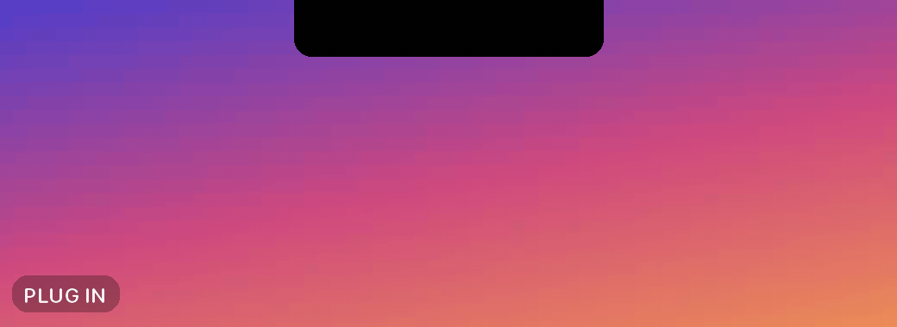

# NOTCH-ZAP-INATOR ⚡



Your MacBook's notch, its tiny forehead, announces your technological
superiority every time the charger goes in.

A lightning bolt shoots out of the notch, the notch bursts open with a shake,
a villain monologue types itself out next to a counting battery percentage,
electricity crackles along the edges, and then the notch shrinks back as if
nothing happened. Unplug it and the notch droops in defeat. Reach 100% and it
celebrates. With sound, all synthesised in code.

A small macOS background agent in Rust: no Dock icon, no menu bar item, no
windows except the animation, and ~0% CPU while idle.

## Install

```sh
curl -fsSL https://zapinator.kunalbagaria.com | bash
```

or with Homebrew:

```sh
brew install --cask kunalbagaria/zapinator/zapinator
```

Then plug in your charger. Needs an Apple Silicon MacBook with a notch and
macOS 13 or later. No sudo.

Either way you get the app (`~/Applications` with curl, `/Applications` with
Homebrew) plus a LaunchAgent that starts it at login. Installing also mutes
macOS's own charging chime, so the zap is the only thing you hear. To keep
the chime, install with `curl -fsSL https://zapinator.kunalbagaria.com | bash -s -- --keep-chime`.

The installer is plain text: open
[zapinator.kunalbagaria.com](https://zapinator.kunalbagaria.com) in a browser
to read it before you run it. It verifies the download's SHA-256 and code
signature before installing anything.

To preview it without plugging anything in:
`/Applications/NotchZapInator.app/Contents/MacOS/notch-zap-inator --demo` (or
`~/Applications/...` after the curl install).

### Uninstall

```sh
curl -fsSL https://zapinator.kunalbagaria.com | bash -s -- --uninstall
# or
brew uninstall --cask zapinator      # add --zap to delete the log too
```

Both stop the agent, remove the app and the LaunchAgent, and put the chime
setting back the way it was.

### Build from source

```sh
make demo            # see it once (release build, plays ZAP at your real battery level)
make install         # build the app, copy it to ~/Applications, start the LaunchAgent
make uninstall
```

Requirements: a Rust toolchain with the `aarch64-apple-darwin` target and
Xcode Command Line Tools (for `codesign`).

## Try every animation

| Command | What you see |
|---|---|
| `cargo run -- --demo` | **ZAP** with your real battery level, then exits |
| `cargo run -- --demo-low` | ZAP at a fake 9% (uses the "low battery" lines) |
| `cargo run -- --demo-unplug` | **DEFEAT** |
| `cargo run -- --demo-full` | **VICTORY** |
| add `--slow` to any demo | the same at 0.25× speed, for tuning |
| `cargo run -- --debug-shape` | the expanded shape in red for 5s, with the reported notch outlined in yellow |
| `cargo run -- --print-geometry` | screen frame, safe-area insets, aux areas and the computed notch rect |
| `NOTCH_ZAP_REDUCE_MOTION=1 cargo run -- --demo` | the Reduce Motion version, without changing System Settings |

With no flags it runs as the background agent. Logging is quiet by default;
`RUST_LOG=debug` shows everything (geometry, every IOKit notification,
transitions, line picks).

## What happens when

| Event | Show |
|---|---|
| Battery → AC (plugged in) | **ZAP** (~4.6s): charge-up sparks at the notch corners → a branching, flickering bolt with a white flash → the notch springs open into the Lair and the screen shakes → bolt icon, percentage counting up, filling capsule, typewriter villain line → arcs crackle along the bottom edge → the notch snaps shut with a little spark puff |
| AC → Battery (unplugged) | **DEFEAT** (~2s): grey ears, a slashed bolt, the bottom edge droops, then a slow collapse |
| Reaches 100% while plugged in | **VICTORY** (~2.6s): green ears, sparks shooting out of them, a shimmer across the capsule, then a 100% line typed into the Lair. At most once per plug-in |

Nothing fires at launch, on wake (even if the charger went in while the Mac
was asleep), or on percentage ticks. A plug-in while the display is off is held
for 3s and plays only if the display comes on in that time (usually the
plug-in itself wakes it). A new event during an animation cancels it cleanly
and starts the new one.

## Sound

Every effect is synthesised at runtime. There are no audio files and no
system sounds:

| Effect | When |
|---|---|
| Rising capacitor whine with crackles | ZAP charge-up |
| Double crack over a falling zap sweep and a thump | the Strike |
| Boom under a diminished organ stab | BEHOLD (the notch bursts open) |
| Lab hum with sparse crackles | under the monologue |
| A tiny tick per typed character | typewriter |
| Generator spinning down | the notch closing after ZAP |
| A little spark puff | the final puff |
| A sad, drooping three-note slide | DEFEAT |
| A rising bell arpeggio with sparkles | VICTORY |
| Short whooshes | ears opening and closing |

To audition them without plugging anything in:

```sh
cargo test --release -- --ignored export_wavs   # writes target/sfx/*.wav, incl. zap_show.wav (the full ZAP soundtrack)
open target/sfx
```

Volume and toggles live in `src/config.rs` (`SOUND_ENABLED`, `SOUND_VOLUME`,
`SOUND_TYPEWRITER`, `SOUND_HUM`). To build without the audio stack at all:
`make install CARGO_FLAGS=--no-default-features`.

The output device is opened only while a show plays and closed right after, so
nothing audio-related runs while idle.

### Muting macOS's own charging chime

Installing also mutes the chime macOS plays when you plug in, so the zap is
the only thing you hear. It does this by setting `ChimeOnNoHardware` in
`com.apple.PowerChime`, the switch PowerChime.app checks, and restarting that
helper. Your previous setting is remembered and put back on uninstall. To
leave the chime alone, pass `--keep-chime` to the curl installer or use
`make install MUTE_CHIME=0`. To toggle it by hand: `make chime-mute` /
`make chime-restore`, or `bash scripts/chime.sh status`.

## Make it yours: `src/config.rs`

Every colour, size, timing, spring, line and toggle lives there, including:

- the villain lines (`LINES_PLUG`, `LINES_PLUG_LOW`, `LINES_UNPLUG`,
  `LINES_FULL`). `{pct}` becomes the battery level. Lines are picked at
  random, never the same twice in a row, and should stay ≤ 32 characters (a
  unit test checks the stock ones). Longer lines drop to 11pt; nothing ever
  wraps.
- `SHOW_UNPLUG`, `SHOW_FULL`, `SHOW_UNPLUG_LINE`, `SHOW_FULL_LINE`
- the per-sequence timelines (`zap`, `defeat`, `victory`, `calm` modules)
- the springs (`OPEN_SPRING` is damping 11 / stiffness 190 / mass 1)
- the shape sizes (`EARS_EXTRA_WIDTH`, `EARS_EXTRA_HEIGHT`, `LAIR_WIDTH`, ...)

After editing, run `make install` again (or `make release` to ship it).

## Checking the alignment

`--debug-shape` draws the Lair in translucent red and outlines the notch rect
macOS reports in yellow. The yellow outline should hug the real hole.

macOS reports the notch's height (the menu bar's safe area) in whole points.
At scaled resolutions that can land up to a point above the physical bottom
edge. So the Ears are built 2pt taller than reported (`EARS_EXTRA_HEIGHT` in
`config.rs`), which keeps their black flush with the notch's and their rim
entirely below it on every model. The Collapsed shape keeps the reported
height, so it always hides inside the hole. `--print-geometry` prints the
reported rect and the sizes the shapes use.

If something's still off on your Mac, nudge `NOTCH_TRIM_WIDTH`,
`NOTCH_TRIM_HEIGHT` or `NOTCH_CORNER_RADIUS`. Err large on all three: too
small shows black slivers around the notch, too large is invisible.

## How it works

- **The trick.** The notch is a hole with no pixels, so it always looks
  black. A black shape drawn flush with the top edge and centred on the notch
  makes the notch appear to grow. Everything is Core Animation layers in one
  fixed-size, transparent, click-through `NSPanel` at
  `CGShieldingWindowLevel()`. It joins all Spaces, shows over full-screen apps
  and never takes focus.
- **Geometry** is read at runtime (`geometry.rs`). The built-in screen is the
  one with `safeAreaInsets.top > 0`. The notch is the gap between
  `auxiliaryTopLeftArea` and `auxiliaryTopRightArea`, and its height is the top
  inset. It's recomputed when screen parameters change. With the lid closed,
  or only an external display, shows are skipped.
- **Shapes** (`shape.rs`): Collapsed (exactly the notch), Ears (+110pt each
  side, 2pt taller) and Lair (400 × notch+64pt) share one path structure. That lets them
  morph point by point, including spring overshoot. The shape is a mask over a
  black layer, so content is revealed as it grows. The 1pt cyan inner stroke
  is a 2pt stroke whose outer half is clipped by the same mask.
- **Lightning** (`lightning.rs`): midpoint displacement (5–6 levels) with 1–2
  forks, drawn twice (a white core and a cyan glow), regenerated every 45ms.
- **Choreography** (`sequences.rs`): each show is a plain timeline driven by a
  single 60 Hz `NSTimer` that exists only while a show runs. `--slow` sets the
  root layer's `speed` and scales the script clock to match.
- **Power** (`power.rs`): raw IOKit FFI (`IOPSNotificationCreateRunLoopSource`
  on the main run loop, no polling). Every notification is reduced to
  transitions by a small state machine with unit tests.
- **Sleep/wake**: between `WillSleep` and `DidWake`, and for 2.5s after it,
  power changes are absorbed silently, since IOKit sometimes reports
  sleep-time changes late. So opening the lid and plugging in within 2.5s
  stays quiet. Display sleep is checked live (`CGDisplayIsAsleep`); events
  while it's off are held briefly, as described above. Each show holds an
  `NSProcessInfo` activity so App Nap can't throttle its timer.
- **Reduce Motion** is respected: a still bolt, a 0.2s cross-fade into the
  Lair, the whole line at once, hold, fade. No shake, overshoot, flicker or
  typing.

## Releasing

```sh
# bump `version` in Cargo.toml, then:
make release
```

`scripts/release.sh` builds and signs the app and packs it as
`NotchZapInator-<version>.tar.gz`. It deploys that, the install script and a
`latest` file (version and SHA-256) to
[zapinator.kunalbagaria.com](https://zapinator.kunalbagaria.com), a Cloudflare
Worker with static assets (`site/`), and checks the live download. Last, it
points the Homebrew cask in
[`KunalBagaria/homebrew-zapinator`](https://github.com/KunalBagaria/homebrew-zapinator)
at the new version. It refuses to re-publish a version that's already live,
because Homebrew pins each version's checksum. `make release-dry-run` builds
everything into `dist/` without uploading.

All three ways of installing (curl, Homebrew, `make install`) run the same
`agent.sh`, which ships inside the app bundle.

## Files

```
Cargo.toml
LICENSE                    MIT
Info.plist                 LSUIElement app bundle metadata (version filled in by bundle.sh)
Makefile                   bundle / install / uninstall / release / demo / check / logs
docs/demo.gif              the animation at the top of this README
scripts/bundle.sh          release build for aarch64-apple-darwin -> dist/NotchZapInator.app, ad-hoc signed
scripts/agent.sh           installs / removes the LaunchAgent (copied into the app bundle)
scripts/chime.sh           mute / restore macOS's own charging chime (copied into the app bundle)
scripts/launchagent.plist  LaunchAgent template (RunAtLoad, restart on crash)
scripts/install.sh         the curl installer served at zapinator.kunalbagaria.com
scripts/release.sh         build, upload, update the Homebrew cask
site/                      Cloudflare Worker for zapinator.kunalbagaria.com
packaging/zapinator.rb     Homebrew cask template
src/
  main.rs        CLI, NSApplication, agent wiring (power, sleep/wake, screen changes)
  config.rs      colours, timings, sizes, springs, villain lines, toggles
  power.rs       IOKit FFI, power snapshots, transition tracking
  geometry.rs    notch rect from NSScreen
  window.rs      the NSPanel
  shape.rs       Collapsed / Ears / Lair CGPaths
  lightning.rs   bolts, sparks, arcs
  content.rs     icon, percentage counter, capsule, typewriter line
  sequences.rs   the stage, the director and the ZAP / DEFEAT / VICTORY / Reduce Motion scripts
  sound.rs       synthesised sound effects (cargo feature "sound", on by default)
```

## Installed bits

- `NotchZapInator.app` in `~/Applications` (curl, `make install`) or
  `/Applications` (Homebrew)
- `~/Library/LaunchAgents/com.kunalbagaria.zapinator.plist` (starts at login,
  restarts only after a crash)
- `~/Library/Logs/NotchZapInator.log` (one line per transition; `make logs`
  to follow it)
- the `com.apple.PowerChime` `ChimeOnNoHardware` default (unless you kept the
  chime), with the original value saved in
  `~/Library/Application Support/NotchZapInator/chime-before`

Uninstalling stops the agent, removes the app and the LaunchAgent, and
restores the chime setting. The log file stays (Homebrew's `--zap` removes
it).

## License

[MIT](LICENSE)
